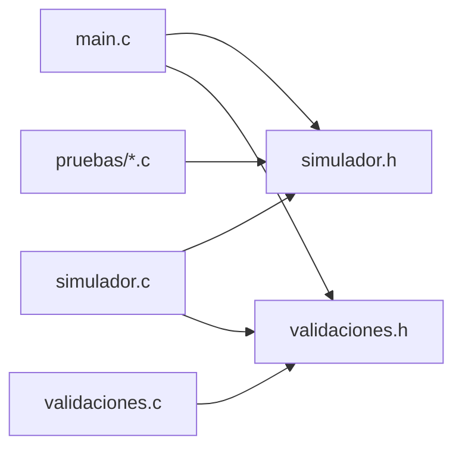

# ARTEMIS - Simulador de Inyección Translunar (TLI)

Simulador interactivo por consola, escrito en C, del escenario Artemis asignado por la cátedra: la inyección translunar de la nave Orion y su vuelo sin propulsión hacia la Luna.

**Universidad Tecnológica Nacional - Facultad Regional Resistencia**<br>
**Asignatura:** Algoritmos y Estructuras de Datos - Laboratorio de C<br>
**Escenario asignado:** Problema 3, *Inyección Translunar - TLI e Inercia en Trayectoria Libre*<br>
**Comisión:** D

## Integrantes

| Legajo | Nombre y apellido |
| --- | --- |
| 25494 | Fernando Germán Ojeda |
| 31126 | Mario Daniel Acevedo |
| 29264 | Yvonne Vallejos |
| 29226 | María Luna Vaz |
| 31340 | Alan Quenardelle |

## Estado del proyecto

El simulador está completo: se juega una misión de principio a fin, se pueden consultar por separado las cuatro preguntas del Problema 3 y cada misión termina con un reporte y un puntaje. Los cálculos se verifican con pruebas automáticas que GitHub Actions ejecuta en cada Pull Request. La organización del trabajo está en el [roadmap de desarrollo](docs/DEVELOPMENT-ROADMAP.md) y en el [tablero del proyecto](https://github.com/users/acevedo-daniel/projects/4).

## Escenario asignado

Según la [consigna](docs/catedra/consigna.pdf), estando en órbita baja (LEO), la etapa superior ICPS ejecuta la maniobra de Inyección Translunar e impulsa a Orion hasta `v_TLI = 10900 m/s`. Después la ICPS se desacopla, los motores se apagan y la nave (`m = 26000 kg`) inicia una trayectoria de retorno libre hacia la Luna, a una distancia media Tierra-Luna `D = 384000000 m`.

A partir de valores ingresados por el usuario, el programa debe responder:

- cómo se comporta el movimiento de Orion sin propulsión según la 1.ª Ley de Newton y cómo la gravedad terrestre la desacelera;
- la energía cinética inicial al comenzar el viaje translunar;
- el trabajo adicional mínimo por unidad de masa para llevar la nave desde la órbita baja (`h = 192000 m`) hasta el punto de equilibrio gravitatorio Tierra-Luna;
- por qué, desde el punto de vista energético, el viaje Tierra-Luna requiere mucho más combustible que el regreso.

## Cómo se juega

El menú principal ofrece cinco opciones:

| Opción | Qué hace |
| --- | --- |
| `1` | **Nueva misión**: se juega la inyección translunar por turnos |
| `2` | **Consultas del Problema 3**: responde por separado las preguntas a, b, c y d con los valores que ingresa el usuario |
| `3` | **Datos y supuestos del modelo**: constantes físicas y simplificaciones usadas |
| `4` | **Último reporte**: vuelve a mostrar el resultado de la última misión |
| `0` | Salir |

Una misión tiene cuatro etapas:

1. **Inyección (pregunta b).** El jugador elige un nivel e ingresa la velocidad de inyección; el programa muestra la energía cinética inicial.
2. **Vuelo sin propulsión (pregunta a).** El trayecto hasta el punto de equilibrio Tierra-Luna se divide en 10 tramos. En cada turno se muestran la barra de progreso, la telemetría (distancia, velocidad, atracción de la Tierra y de la Luna, desaceleración neta y energía cinética) y la predicción del tramo siguiente. El jugador decide **continuar**, **corregir** (aplicar un trabajo en J/kg que sale de la reserva) o **abortar**.
3. **Punto de equilibrio (pregunta c).** Si la nave lo alcanza, la misión es un éxito; si se detiene antes, vuelve a caer hacia la Tierra y la misión fracasa.
4. **Regreso (pregunta d).** El reporte compara la energía necesaria para salir del pozo gravitatorio de la Tierra con la necesaria para salir del de la Luna.

**Niveles.** Prueba sin tripulación (reserva amplia, pocos eventos), Misión tripulada, Misión con carga (reserva justa, eventos frecuentes) y Personalizada, en la que el jugador elige masa, reserva y si hay eventos.

**Eventos.** En cada turno puede ocurrir una fuga de propulsión (la reserva baja entre 10 % y 25 %), una pérdida de señal (ese turno no se puede corregir) o una falla de sensor (ese turno no se muestra la predicción). Ningún evento cambia la física de la nave.

**Puntaje.** De 0 a 100, solo para misiones exitosas: se descuenta la energía aportada de más y cada corrección usada. Con la velocidad de la consigna (10 900 m/s) la nave no llega sin corregir; quien calcula la pregunta c puede elegir una inyección que llega sin correcciones.

Todos los datos se validan por tipo y rango: una entrada inválida muestra un aviso y vuelve a pedir el dato, sin cerrar el programa. Las reglas completas están en la [especificación funcional](docs/PROJECT.md).

## Estructura del código

| Archivo | Responsabilidad |
| --- | --- |
| `src/main.c` | Solo `main()`: bienvenida, menú principal y despacho de opciones; guarda el último reporte |
| `src/simulador.h` | Constantes, `struct`/`typedef` (`EstadoNave`, `ParametrosMision`, `Telemetria`, `Evento`, `Nivel`, `ReporteFinal`) y prototipos |
| `src/simulador.c` | Cálculos físicos, estado de la nave, eventos, puntaje, niveles, consultas, turno en pantalla, misión y reporte |
| `src/validaciones.h` / `src/validaciones.c` | Ingreso seguro de enteros, reales y caracteres, con reintento ante entradas inválidas |
| `pruebas/` | Pruebas automáticas de los cálculos, la nave, los niveles, el reporte y las consultas |



Las funciones que modifican la nave o el reporte los reciben por puntero; los niveles predefinidos están en un arreglo de `struct` que se recorre por índice. El detalle está en [docs/ARCHITECTURE.md](docs/ARCHITECTURE.md).

## Compilación y ejecución

### Requisitos

- **GCC** y **make**.
  - Linux: paquete `build-essential` (Debian/Ubuntu) o `gcc` y `make` de la distribución.
  - macOS: `xcode-select --install`.
  - Windows: [WinLibs](https://winlibs.com/) (GCC con MinGW-w64), con su carpeta `bin` agregada al `PATH`; en WinLibs, `make` se llama `mingw32-make`.
- Para comprobarlo: `gcc --version`.

### Pasos

```bash
git clone https://github.com/acevedo-daniel/artemis-tli.git
cd artemis-tli
```

| Sistema | Compilar | Ejecutar | Pruebas automáticas |
| --- | --- | --- | --- |
| Linux o macOS | `make` | `./artemis_tli` | `make pruebas` |
| Windows (PowerShell) | `mingw32-make` | `.\artemis_tli.exe` | `mingw32-make pruebas` |

Sin `make`, el programa se compila con:

    gcc -std=c11 -Wall -Wextra -pedantic -Werror src/main.c src/simulador.c src/validaciones.c -o artemis_tli -lm

Las advertencias se tratan como errores: el código compila sin ninguna. `make pruebas` compila y ejecuta los dos programas de `pruebas/`; cada uno termina con `… 0 fallas` si todos los cálculos coinciden con los casos de referencia. El detalle está en [docs/TESTING.md](docs/TESTING.md).

### Jugar una misión paso a paso

Ejecutar el programa (`./artemis_tli` o `.\artemis_tli.exe`). En cada pantalla se escribe la respuesta y se presiona Enter.

1. **Menú principal:** escribir `1` (Nueva misión).
2. **Nivel:** escribir un número del `1` al `4`. Los niveles 1 a 3 ya traen masa, reserva y eventos. El `4` (Personalizada) pide la masa (por ejemplo `26000`), la reserva de corrección (por ejemplo `150000`) y si se activan los eventos (`s` o `n`).
3. **Inyección:** escribir la velocidad de inyección, entre `10500` y `11200` m/s (la de la consigna es `10900`). El programa muestra la energía cinética inicial.
4. **Turnos (10 tramos):** en cada turno se ven la barra de progreso, la telemetría, la predicción del tramo siguiente y la reserva. Escribir:
   - `c` para **continuar** al tramo siguiente;
   - `r` para **corregir**: pide el trabajo en J/kg (no más que la reserva), acelera la nave y vuelve a mostrar la predicción;
   - `a` para **abortar** la misión.
5. **Fin:** si la nave llega al punto de equilibrio es un **éxito**; si la predicción dice `La nave no alcanza el próximo punto` y se elige continuar, la nave vuelve a caer y es un **fracaso**. Se muestra el reporte final con el puntaje.
6. De vuelta en el menú: `4` muestra otra vez el último reporte, `2` abre las consultas del Problema 3 y `0` sale.

**Para ganar:** con 10 900 m/s la nave se queda corta en el último tramo. Cuando la predicción avisa `La nave no alcanza el próximo punto`, hay que corregir (`r`) antes de continuar; otra opción es calcular con la consulta `c` la velocidad que llega sola (10 906 m/s alcanza). Cuanto menos energía de más y menos correcciones, mejor puntaje.

### Prueba rápida

Para repetir siempre el mismo resultado, elegir el nivel **4 (Personalizada)** y responder **`n`** a los eventos. Cada dato se escribe y se confirma con Enter (los valores por defecto se escriben, no se dejan vacíos).

| Qué probar | Qué ingresar | Resultado esperado |
| --- | --- | --- |
| Misión fallida | `1` → nivel `4` → masa `26000`, reserva `150000`, eventos `n` → velocidad `10900` → `c` en cada turno | En el turno 10 la nave no alcanza el equilibrio, vuelve a caer y el reporte dice Fracaso |
| Misión exitosa corrigiendo | Igual, pero en el turno 10 elegir `r` y aplicar `60000` J/kg; después `c` | La nave llega al punto de equilibrio; el reporte dice Éxito, con puntaje descontado por la corrección |
| Misión exitosa sin corregir | Igual que la primera, con velocidad `10906` | Llega sin correcciones; puntaje 99,6 |
| Consultas | `2` → `a`, `b`, `c` o `d` → `s` (valores por defecto); `v` vuelve al menú | Resultados de las preguntas del Problema 3 (por ejemplo, `c` por defecto: trabajo mínimo 59 462 086 J/kg) |
| Entradas inválidas | Letras, línea vacía, `1.5` o valores fuera de rango en cualquier dato | Aviso y nuevo pedido del dato, sin cerrar el programa |
| Último reporte | `4` después de jugar | Vuelve a mostrar el reporte de la última misión |

## Documentación

- [Especificación funcional](docs/PROJECT.md): escenario, supuestos del modelo, reglas del juego, entradas, resultados y casos de prueba.
- [Arquitectura](docs/ARCHITECTURE.md): módulos, estructuras, funciones públicas y flujo entre archivos.
- [Pruebas](docs/TESTING.md): cómo se comprueban los cálculos contra los casos de referencia.
- [Roadmap de desarrollo](docs/DEVELOPMENT-ROADMAP.md): etapas, alcance y criterios de finalización.
- [Tablero del proyecto](https://github.com/users/acevedo-daniel/projects/4): seguimiento de tareas y estado del desarrollo.
- [Guía de trabajo con GitHub](docs/DEVELOPMENT.md): cómo tomar una tarea, crear ramas, abrir Pull Requests y revisar.
- [Cálculos de referencia](docs/calculos/README.md): desarrollos a mano de las preguntas del Problema 3.
- [Consigna de la cátedra](docs/catedra/consigna.pdf).

## Registro de uso de inteligencia artificial

La consigna exige registrar cada uso de herramientas de IA: herramienta, tarea, consultas realizadas y cómo se validó o adaptó el resultado. Cada integrante agrega una línea, con el formato `fecha · integrante · herramienta - tarea. Consulta: … Validación: …`, en el mismo Pull Request que incorpora el trabajo asistido.

- 10/11/2026 · Mario Daniel Acevedo · Claude Code (Anthropic) - Auditoría de la documentación inicial y de la base de colaboración (formularios, plantilla de Pull Request, `.gitignore`, `AGENTS.md`, README, guía de GitHub y roadmap). Consulta: revisión de los documentos iniciales y plan para las primeras tareas del equipo. Validación: cada archivo revisado contra la consigna; configuración de GitHub verificada con `gh`.
- 11/11/2026 · Mario Daniel Acevedo · Claude Code (Anthropic) - Auditoría de la base y del roadmap; reglas de idioma y traducción de formularios. Consulta: comprobar que el roadmap coincida con la consigna y definir reglas para escribir el proyecto en español. Validación: roadmap comparado con la consigna y la rúbrica; formularios validados como YAML.
- 11/11/2026 · Mario Daniel Acevedo · Codex (OpenAI) - Integración de la base de colaboración en un único Pull Request y revisión del `.gitignore`. Consulta: unificar los cambios de la base con un Pull Request previo del equipo. Validación: cambios comparados con el Pull Request existente; `git diff --check`.
- 12/11/2026 · Alan Quenardelle · Claude (Anthropic) - Cálculo y corrección del punto de equilibrio Tierra-Luna (#12 y #17). Consulta: desarrollo paso a paso del cálculo y de su corrección. Validación: valores recalculados por Daniel Acevedo; corrección del redondeo pedida en el Issue #7.
- 12/11/2026 · Mario Daniel Acevedo · Claude Code (Anthropic) - Auditoría de la etapa inicial y plan correctivo. Consulta: auditoría de la primera etapa y plan de correcciones. Validación: Issues, Pull Requests y reglas del repositorio verificados con `gh`; valores físicos recalculados con Python.
- 12/11/2026 · Mario Daniel Acevedo · Claude Code (Anthropic) - Normalización del formato de los cálculos de referencia. Consulta: unificar el formato respetando la autoría de cada integrante. Validación: diff revisado para conservar el trabajo de cada autor; redondeo del punto de equilibrio corregido.
- 12/11/2026 · Mario Daniel Acevedo · Claude Code (Anthropic) - Idea inicial del juego y supuestos del modelo en `docs/PROJECT.md`. Consulta: diseño de un juego fiel a la consigna, con misión en cuatro etapas, correcciones, eventos y niveles. Validación: consigna y rúbrica releídas; velocidades por tramo y trabajo mínimo recalculados con Python.
- 13/11/2026 · Alan Quenardelle · Claude Sonnet 4.6 (Anthropic) - Especificación de las preguntas a-d, entidades, flujo de consola y casos de entradas inválidas y recorridos (#30, #31, #32, #34 y #35). Consulta: desarrollo de las secciones pedidas en los Issues #24 a #27 y #29. Validación: revisión de Daniel Acevedo con valores recalculados en Python; ajustes integrados en #36.
- 13/11/2026 · Mario Daniel Acevedo · Gemini (Google) - Casos de prueba de los cálculos y de las reglas de equilibrio (#37). Consulta: cálculo de los casos normales, límites y de reglas pedidos en el Issue #28. Validación: los 20 resultados esperados recalculados con Python.
- 13/11/2026 · Mario Daniel Acevedo · Claude Code (Anthropic) - Auditoría de la etapa de definición del escenario y plan correctivo. Consulta: revisión de los Pull Requests integrados y plan con las correcciones necesarias. Validación: valores de referencia recalculados con Python; correcciones aplicadas en #36.
- 13/11/2026 · María Luna Vaz · Claude Code (Anthropic) - Documentación de los datos y constantes del escenario (Issue #23). Consulta: cómo documentar paso a paso los datos y constantes. Validación: datos y constantes revisados contra la consigna.
- 13/11/2026 · Alan Quenardelle · Claude Sonnet 4.6 (Anthropic) - Ingreso validado de enteros, reales y caracteres en `src/validaciones.c` (#46 y #47). Consulta: cómo leer enteros, reales y caracteres con `fgets`, `strtol` y `strtod` para rechazar letras, líneas vacías y valores fuera de rango (Issues #42 y #43). Validación: compilación sin advertencias y pruebas por consola con entradas inválidas (`a`, línea vacía, `1.5`, `abc`, `nan`, valores fuera de rango).
- 13/11/2026 · Fernando Germán Ojeda · Meta AI - Menú principal (#41). Consulta: menú principal de `src/main.c` según el Issue #41, con bienvenida, menú, `switch` y llamada a `leer_entero`. Validación: compilación con `mingw32-make` sin advertencias; recorridos del menú por consola según el Issue.
- 13/11/2026 · Mario Daniel Acevedo · Claude Code (Anthropic) - Auditoría de cierre de la estructura modular y plan de corrección. Consulta: análisis de cierre de la etapa y plan de corrección. Validación: archivos de la etapa verificados contra los criterios de cierre; plan ejecutado en #51.
- 13/11/2026 · Mario Daniel Acevedo · Codex (OpenAI) - Cierre de la estructura modular: ajustes de presentación y actualización de la documentación. Consulta: implementación de la tarea de cierre planificada. Validación: compilación y recorridos del menú.
- 14/11/2026 · Mario Daniel Acevedo · Gemini (Google), en Antigravity - Base del núcleo de cálculo y pruebas automáticas (contrato en `simulador.h`, base física en `simulador.c` y `pruebas/pruebas_simulador.c`). Consulta: implementación de la primera tarea del plan del núcleo de cálculo. Validación: `mingw32-make && mingw32-make pruebas` sin advertencias (9 pruebas, 0 fallas).
- 14/11/2026 · Alan Quenardelle · Claude Sonnet 4.6 (Anthropic) - Atracciones y telemetría (#58) y eventos y puntaje (#61). Consulta: fórmulas de atracción gravitatoria y telemetría, sorteo de eventos con `rand()` y cálculo del puntaje (Issues #53 y #57). Validación: compilación sin advertencias y `make pruebas` sin fallas (19 y 22 pruebas).
- 14/11/2026 · Fernando Germán Ojeda · ChatGPT (OpenAI) - Energía cinética y pozos gravitatorios (#54). Consulta: implementación de `calcular_energia_cinetica`, `calcular_pozo_tierra` y `calcular_pozo_luna`, con trece pruebas. Validación: `mingw32-make` y `mingw32-make pruebas` (22 pruebas, 0 fallas).
- 14/11/2026 · Fernando Germán Ojeda · ChatGPT (OpenAI) - Trabajo mínimo y distancia máxima (#55). Consulta: implementación de `calcular_trabajo_minimo` y `calcular_distancia_maxima` con sus nueve pruebas. Validación: `mingw32-make` sin advertencias y `mingw32-make pruebas` (18 pruebas, 0 fallas).
- 14/11/2026 · Alan Quenardelle · Claude Sonnet 4.6 (Anthropic) - Niveles de misión (#77) y turno de vuelo en pantalla (#78). Consulta: arreglo de niveles con acceso por índice y pantalla del turno con barra de progreso y predicción (Issues #72 y #73). Validación: `make pruebas` sin fallas (86 pruebas, incluida la Regla 2 por nivel) y comprobación por consola del turno contra el Recorrido de referencia.
- 14/11/2026 · María Luna Vaz · ChatGPT (OpenAI) - Submenú de consultas y preguntas a, b, c y d en `src/simulador.c`, con ajuste del `Makefile`. Consulta: uso correcto de `leer_caracter` y `leer_real` según `docs/PROJECT.md`. Validación: compilación con GCC y pruebas automáticas sin fallas.
- 14/11/2026 · Mario Daniel Acevedo · Codex (OpenAI) - Revisión de las consultas c y d: orden de argumentos, unidades, potenciales y pruebas de regresión por consola. Consulta: revisión del Pull Request de las consultas antes de integrarlo. Validación: fallas reproducidas antes de corregir; `mingw32-make` y `mingw32-make pruebas` después.
- 14/11/2026 · Mario Daniel Acevedo · Codex (OpenAI) - Revisión del reporte final: unidades de los pozos y de las energías totales; resolución de conflictos con `main`. Consulta: revisión del Pull Request del reporte antes de integrarlo. Validación: compilación, pruebas y comparación del reporte por consola antes y después.
- 14/11/2026 · Alan Quenardelle · Claude Sonnet 4.6 (Anthropic) - Misión completa: `nueva_mision`, ciclo de tramos, eventos y correcciones (#80). Consulta: ciclo de tramos con las decisiones continuar, corregir y abortar, y validación de la corrección contra la reserva (Issue #75). Validación: compilación sin advertencias y `make pruebas` sin fallas (86 pruebas).
- 14/11/2026 · Alan Quenardelle · Claude Sonnet 4.6 (Anthropic) - Registro de los recorridos del juego y de las entradas inválidas en `docs/TESTING.md`, y corrección del mensaje sin misiones jugadas (#82). Consulta: ejecución y registro de los casos pedidos en el Issue #76. Validación: cada caso ejecutado por consola y comparado con `docs/PROJECT.md`.
- 14/11/2026 · Mario Daniel Acevedo · Claude Code (Anthropic) - Revisión del README para la presentación: secciones Cómo se juega y Estructura del código, estado del proyecto y registro de IA completo. Consulta: revisión del README de cara a la entrega. Validación: contenido comparado con el código y los Pull Requests integrados; `mingw32-make && mingw32-make pruebas` (96 + 9 pruebas, 0 fallas).
- 14/11/2026 · Mario Daniel Acevedo · Claude Code (Anthropic) - Revisión final contra la consigna: textos de consola uniformes y con tildes, constantes en lugar de valores repetidos en las consultas, reporte final con velocidad final y correcciones usadas, comentarios y documentación actualizados. Consulta: auditoría del proyecto completo antes de la entrega, sin cambiar la lógica del simulador. Validación: `mingw32-make && mingw32-make pruebas` (96 + 9 pruebas, 0 fallas) y recorridos de éxito, fracaso, consultas y entradas inválidas repetidos por consola con los mismos resultados.
- 14/11/2026 · Mario Daniel Acevedo · Codex (OpenAI) - Notas de la versión 1.0.0 y uso de guiones simples en la documentación. Consulta: preparar el PR de cierre con textos concretos. Validación: compilación, pruebas automáticas y recorridos por consola.

- 15/11/2026 · Mario Daniel Acevedo · Codex (OpenAI) - Auditoría y corrección de los registros de verificación de Yvonne, conservando la documentación y el historial de IA existentes. Consulta: auditar y corregir sus Pull Requests para proteger el proyecto. Validación: clonación nueva, compilación con make y GCC, 96 + 9 pruebas sin fallas y recorridos de misión, consultas y entradas inválidas ejecutados por consola; mensajes contrastados con el código.
