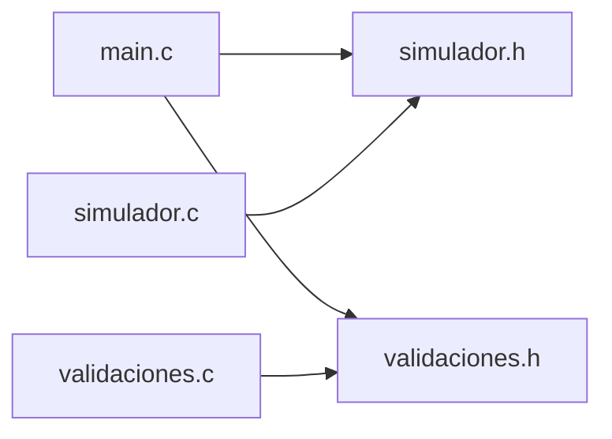

# Simulador Artemis TLI — Arquitectura

> Organización de los módulos en C, dependencias entre archivos, estructuras de datos, funciones públicas y flujo de ejecución desde `main()`.

## Módulos

| Archivo | Responsabilidad | Incluye |
| --- | --- | --- |
| `src/main.c` | Únicamente `main()`, bienvenida, menú principal, almacenamiento del último reporte y despacho de opciones | `"simulador.h"`, `"validaciones.h"`, `<stdio.h>` (y `<windows.h>` en Windows) |
| `src/simulador.h` | Constantes del escenario y reglas (`#define`), definiciones `typedef` (`enum` y `struct`) y prototipos públicos de simulación y física | — |
| `src/simulador.c` | Implementación de las opciones de simulación, presentación de datos y supuestos, y lógica física | `"simulador.h"`, `<math.h>`, `<stdio.h>`, `<stdlib.h>` |
| `src/validaciones.h` | Prototipos públicos para la lectura validada de enteros, reales y caracteres | — |
| `src/validaciones.c` | Lectura segura por línea (`leer_linea`) y validación por tipo y rango con reintento ante entradas inválidas | `"validaciones.h"`, `<ctype.h>`, `<errno.h>`, `<limits.h>`, `<stdio.h>`, `<stdlib.h>`, `<string.h>` |
| `pruebas/pruebas_simulador.c` | Pruebas automáticas de los cálculos físicos, el estado de la nave, eventos y puntaje contra los casos de referencia | `"simulador.h"`, `<math.h>`, `<stdio.h>`, `<stdlib.h>` |

## Dependencias entre archivos

## Estructuras

Las reglas de negocio y el diseño conceptual de estas entidades se detallan en [PROJECT.md › Entidades candidatas a struct](PROJECT.md#entidades-candidatas-a-struct). En `src/simulador.h` se definen los siguientes `typedef`:

- `ResultadoMision`: enumera los estados posibles de una misión (en curso, éxito, fracaso o abortada); forma parte de `ParametrosMision` y `ReporteFinal`, y `calcular_puntaje` lo recibe para decidir si corresponde puntuar la misión.
- `TipoEvento`: enumera los tipos de incidente de turno (ninguno, fuga de propulsión, pérdida de señal o falla de sensor); integra la estructura `Evento` y lo utilizan `generar_evento` y `aplicar_evento`.
- `EstadoNave`: agrupa punto actual (`0` a `CANTIDAD_TRAMOS`), distancia, velocidad, reserva de corrección, trabajo aplicado y cantidad de correcciones aplicadas de la nave durante el vuelo; las funciones de estado (`inicializar_nave`, `aplicar_correccion`, `avanzar_nave`, `recorrer_sin_correcciones`), `calcular_telemetria` y `aplicar_evento` la reciben por puntero.
- `ParametrosMision`: reúne masa, velocidad de inyección, índice de nivel y resultado de una misión; definida como contrato, todavía sin funciones implementadas que la reciban.
- `Telemetria`: concentra distancia, velocidad, atracciones gravitatorias, desaceleración neta y energía cinética de un turno; `calcular_telemetria` la completa por puntero a partir de `EstadoNave`.
- `Evento`: combina un `TipoEvento` con el porcentaje de reserva afectado; `generar_evento` lo completa por puntero y `aplicar_evento` lo lee por puntero.
- `ReporteFinal`: consolida datos iniciales, resultado, métricas de vuelo, balance de trabajo y puntaje de una misión terminada; `main()` reserva una instancia y la pasa por puntero a `nueva_mision` y `mostrar_ultimo_reporte`.

## Funciones públicas

| Prototipo | Módulo | Estado |
| --- | --- | --- |
| `int nueva_mision(ReporteFinal *reporte);` | `simulador` | provisional |
| `void submenu_consultas(void);` | `simulador` | provisional |
| `void mostrar_datos_y_supuestos(void);` | `simulador` | implementada |
| `void mostrar_ultimo_reporte(const ReporteFinal *reporte);` | `simulador` | provisional |
| `double calcular_atraccion_tierra(double distancia);` | `simulador` | implementada |
| `double calcular_atraccion_luna(double distancia);` | `simulador` | implementada |
| `double calcular_energia_cinetica(double masa, double velocidad);` | `simulador` | implementada |
| `double calcular_energia_potencial_por_kg(double distancia);` | `simulador` | implementada |
| `double calcular_punto_equilibrio(void);` | `simulador` | implementada |
| `double calcular_trabajo_minimo(double velocidad, double altitud);` | `simulador` | implementada |
| `double calcular_pozo_tierra(double altitud);` | `simulador` | implementada |
| `double calcular_pozo_luna(void);` | `simulador` | implementada |
| `int calcular_velocidad_en(double distancia_inicial, double velocidad_inicial, double distancia, double *velocidad);` | `simulador` | implementada |
| `double calcular_distancia_maxima(double distancia_inicial, double velocidad_inicial);` | `simulador` | implementada |
| `double calcular_distancia_punto(int punto);` | `simulador` | implementada |
| `void inicializar_nave(EstadoNave *nave, double velocidad_inyeccion, double reserva);` | `simulador` | implementada |
| `void calcular_telemetria(const EstadoNave *nave, Telemetria *telemetria);` | `simulador` | implementada |
| `int aplicar_correccion(EstadoNave *nave, double trabajo);` | `simulador` | implementada |
| `int avanzar_nave(EstadoNave *nave);` | `simulador` | implementada |
| `int recorrer_sin_correcciones(EstadoNave *nave, double velocidades[]);` | `simulador` | implementada |
| `void generar_evento(Evento *evento, int probabilidad, int nave_alcanza_siguiente);` | `simulador` | implementada |
| `void aplicar_evento(EstadoNave *nave, const Evento *evento);` | `simulador` | implementada |
| `double calcular_puntaje(ResultadoMision resultado, double velocidad_inyeccion, double trabajo_aplicado, int correcciones);` | `simulador` | implementada |
| `int leer_entero(const char *mensaje, int minimo, int maximo, const char *aviso_rango);` | `validaciones` | implementada |
| `double leer_real(const char *mensaje, double minimo, double maximo, const char *aviso_rango);` | `validaciones` | implementada |
| `char leer_caracter(const char *mensaje, const char *opciones_validas, const char *aviso_invalido);` | `validaciones` | implementada |

## Flujo

Al iniciar, `main()` configura la salida UTF-8 en Windows, declara `ultimo_reporte` junto con la bandera `hay_reporte` en `0` y llama a `mostrar_bienvenida()`.
Luego ejecuta un ciclo `do-while` donde `mostrar_menu_principal()` lista las opciones y `leer_entero()` valida la elección entre `0` (`OPCION_SALIR`) y `4` (`OPCION_MENU_MAXIMA`).
Según la opción elegida, un `switch` despacha a `nueva_mision(&ultimo_reporte)`, `submenu_consultas()`, `mostrar_datos_y_supuestos()` o `mostrar_ultimo_reporte(...)`, y al terminar cada acción regresa al menú.
El último reporte vive en `main()` dentro de `ultimo_reporte`: `nueva_mision` recibe su dirección para escribirlo y solo cuando devuelve distinto de `0` se activa `hay_reporte = 1`.
Al seleccionar la opción `4`, `main()` pasa `ultimo_reporte` por puntero de solo lectura (`const ReporteFinal *`) a `mostrar_ultimo_reporte`, enviando `NULL` cuando `hay_reporte` vale `0` porque todavía no se jugó ninguna misión.
Cuando el usuario elige `0`, el bucle termina, se imprime el mensaje de despedida y `main()` retorna `0`.
